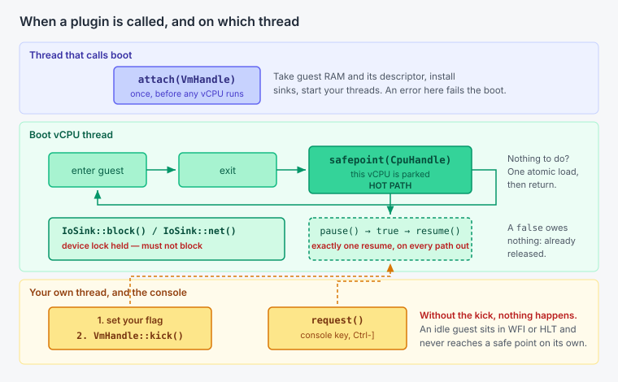

# Writing a tool

A VMM is a useful place to stand. It holds the guest's memory, it can park the
vCPUs between guest entries, and it is the other end of every virtio request
the guest makes. Debuggers, tracers, profilers and crash-dumpers want one or
more of those, and none of them belongs in the exit loop.

So the exit loop offers them instead. That offer is
[`src/plugin/api.rs`](../src/plugin/api.rs), and it is four traits wide.

[`examples/watch_guest.rs`](../examples/watch_guest.rs) is a complete extension
in one file, compiled by CI. Read it alongside this page. The two tools in
[`src/plugin/builtin.rs`](../src/plugin/builtin.rs) are the larger worked
examples.

For constructing the `BootConfig` that carries a plugin, read
[embedding.md](embedding.md).

## When each hook runs



| Trait | Called | Thread |
| --- | --- | --- |
| `Plugin::attach` | once, from `boot()`, before any vCPU thread exists and before the sandbox is entered | the thread that calls `boot` |
| `Plugin::safepoint` | between guest entries, only when `cpu_id == 0` | the boot vCPU |
| `Plugin::request` | when the console reads `Ctrl-]` (0x1d) | the console input thread |
| `IoSink::block`, egress `IoSink::net` | per request or frame, device lock held | a vCPU thread |
| ingress `IoSink::net`, under `--net-tap` or `--net-gateway` | per frame, device lock held | the tap or gateway reader thread |
| ingress `IoSink::net`, under the built-in `--net-stub` stack | per reply, device lock held | a vCPU thread, inside the transmit path |

All three methods on `Plugin` are defaulted, so an implementation takes only
what it needs. All three backends call all three hooks.

## The six rules that fail quietly

**1. `safepoint` is on the hot path.** It sits at the top of the vCPU run
loop, so it runs once per guest entry. A tool with nothing to do this time
round must establish that with one atomic load and return.

**2. A pause you win, you owe.** `cpu.pause()` parks every *other* vCPU that has
started and returns `true` once they are all there. You then owe exactly one
`resume()`, on every path out, including early returns and error paths. Miss one
and the VM stays parked forever.

`false` means they did not all park within 500 ms, or the VM stopped during the
wait. The quiesce has already been released, and you owe nothing. Returning
without a `resume()` on that path is correct.

```rust
if !cpu.pause() {
    return;                 // correct: pause already released it
}
let sample = read_what_you_need(cpu);
cpu.resume();               // before anything that can fail or return
report(sample);
```

A pause parks the vCPUs only. The host side keeps writing guest RAM while they
are parked. The network relay and the agent bridge deliver what arrives for the
guest, and a virtio-fs export answers the requests already on its queue, from
hvi's worker thread on macOS and from the daemon on Linux. Memory those devices
own can change under a read the pause holds.

A `safepoint` may hold the pause while it waits, for example for another process
to finish reading. It checks `cpu.is_stopping()` as it waits. Once that returns
`true`, it resumes and returns. The stop waits one second for the boot vCPU,
then leaves its thread running and fails the run. On Linux the vCPU seccomp
filter refuses `std::thread::sleep`, so a `safepoint` waits with
`Condvar::wait_timeout` or `std::thread::park_timeout`, which the filter allows.

A `safepoint` that waits a long time holds a pause while it waits. The other
vCPUs then sit out the wait as well, and on x86-64 the guest is notified of it.
A boot vCPU that waits alone while the others run looks to the guest like a
stalled CPU, and the guest can report it.

A plugin that needs the run to end calls `VmHandle::request_stop()`, from any
thread. `boot` then returns `Stop::Requested`, unless a thread reports a
failure, or a vCPU a guest stop, before `boot` reads how the run ended.

**3. Set a flag, then kick.** If your own thread decides it is time to act,
set your flag and then call `VmHandle::kick()`. An idle guest sits in WFI on
arm64 or HLT on x86 and does not reach `safepoint` on its own, so without the
kick your request waits for the next unrelated exit, or never lands.

This is the easiest thing to get wrong, and it fails only against idle guests,
which is to say not on your desk.

`kick()` breaks the boot vCPU out of the hypervisor, since it is the one that
reaches `safepoint`. The other vCPUs keep running.

A `kick()` from the vCPU's own thread, inside `safepoint` or an `IoSink` on its
exit path, is dropped. Call it from a thread of your own.

**4. An `IoSink` must not block.** It is called with the device lock held. No
`write(2)`, no allocation you can avoid. Count in the sink, set a dirty flag,
and do the writing in `safepoint`, where slow things are allowed. `IoTrace` is
the worked example. A sink must not keep the `VmHandle` either: the device holds
the sink and the handle holds the device, so the three would keep one another
alive after `boot` returns. A sink that needs the handle keeps a `Weak` from
`Arc::downgrade`.

**5. `request` must return promptly.** It runs on the VMM's console thread, and
the stop waits for that thread. A `request` still running a second after the
stop leaves its thread running, and `boot` returns an error naming it. Set a
flag and return, as `MemoryDump` does; the backend kicks once `request` returns.

**6. Start your threads with `VmHandle::spawn`.** Call it from `attach`, with a
name and a boxed closure that takes a `hvi::teardown::StopToken`. The VMM starts
the thread once the attach has succeeded, under the same seccomp filter as its
own I/O threads on Linux, and joins it with them when the run stops. The token
reports the stop once the vCPUs have exited or been left running: wait on it
with `wait`, `sleep` or `keep_waiting`, or add its descriptor to your own `poll`
set, and return when it fires. A thread still running a second after the token
reports the stop is left running and fails the run, and a thread that panics
fails the run and stops it. Open files and bind sockets in `attach`, since the
filter refuses them. A thread you start any other way is neither joined nor
filtered, and it keeps the `VmHandle` and the VM it holds alive for as long as
it runs.

## Reading guest memory

`CpuHandle::ram()` borrows the VMM's own mapping, which is writable. If your
tool only reads, build a `GuestRamView` over `VmHandle::ram_fd()` and
`ram_regions()` instead, as `MemoryDump` does: duplicate the descriptor with
`try_clone_to_owned()`, pair it with each region, and pass the pairs to
`GuestRamView::map`. Build it in `attach`: the constructor checks each object's
length and maps each region, and the seccomp filters that arm after `attach` do
not allow the length check. The type has no write accessor and its pages are
`PROT_READ`, so nothing your tool does through the view can write the guest.
`GuestRam` dereferences to `GuestRamView`, so code written against the view runs
unchanged on `ram()` inside the VMM. A tool outside the VMM process builds the
pairs from the descriptors it was sent, one for each region. When one object
backs every region, the same descriptor pairs with each of them.

Guest RAM is not always one span. `ram_regions()` returns one region on arm64.
On x86-64 it returns one region up to 3328 MiB of guest RAM and two above
that, because RAM stops at the MMIO hole and resumes at 4 GiB. Read
`ram_regions()`. Do not assume a count. Each region's `gpa`, `size` and
`file_offset` are multiples of 1 MiB.

Guest RAM is allocated from a memfd on Linux and a POSIX shared-memory object on
macOS, unlinked as soon as it is created, so `ram_fd()` is a descriptor another
process can map and no other process can open by name. It is a `BorrowedFd` tied
to the handle. It stays open as long as the handle does, and you must not close
it. To hold it past the borrow, on a thread of your own or for an `SCM_RIGHTS`
send, keep the `OwnedFd` that `try_clone_to_owned()` returns. `hvi smoke --shm`
proves that path on macOS.

`RegsView::root` is the architectural translation-base register, TTBR1_EL1 on
arm64 or CR3 on x86-64. The traits hand over access and deliberately no more.
What any of it means is your problem, which is what keeps a tool's idea of the
guest out of the VMM.

## Putting records in the ledger

A tool's records go into the same `--events` stream as the VMM's own:

```rust
#[derive(serde::Serialize)]
struct MyPayload { interesting: u64 }

let payload = MyPayload { interesting };
if let Err(e) = cpu.ledger().emit_payload("boundary", "my-source", &payload) {
    eprintln!("my-tool: ledger: {e}");
}
```

`emit_payload` waits up to 100 ms for the ledger's writer thread to write the
record. A record it returns `Ok` for has reached the kernel, so it survives the
death of the process. When the record is not written in time, the call returns
an error of kind `TimedOut`, and the record stays buffered until the writer
writes it. While the ledger's writes fail, the call returns that error at once.
A payload that fails to serialize, such as a map keyed by a tuple, is not added,
and the call returns an error of kind `InvalidData`. Once the run's `vmm.stop`
record is added, the ledger takes no more records, and the call returns an error
of kind `Other`. A payload is serialized before the ledger's lock is taken, so a
panic in its `Serialize` leaves the ledger as it was.

Records added to a batch are written together, and no other record falls between
them:

```rust
let written = cpu.ledger().batch(|batch| {
    for task in &tasks {
        batch.emit_payload("boundary", "my-source", task);
    }
});
```

A payload in a batch that fails to serialize leaves the whole batch out. A batch
with no records waits for the records added before it. Each call wakes the
writer and waits for its own write: tens of microseconds, and up to 100 ms when
the disk stalls. A loop that calls `emit_payload` once per record pays that wait
once per record, while a batch pays it once, so batch the records of a loop. A
plugin that pauses the guest in `safepoint` calls `resume` before it writes, so
the write does not extend the pause.

The envelope is this crate's and its wire shape is pinned by tests. The
payload is yours, and the VMM never looks inside it. That is the whole of the
coupling between a ledger reader and whatever produced a record.

[observability.md](observability.md#when-a-record-reaches-the-file) says when
the VMM's own records reach the file.

## Panics

A panic in `safepoint`, in the block sink, or in the egress net sink ends the VM
on every backend: the other vCPUs are kicked, the quiesce is released so no vCPU
stays parked, and `boot` returns an error that names the vCPU. The vCPU thread
is named after its vCPU, so the panic report says which one panicked. A panic
that leaves the vCPU thread is caught where the thread starts, and its message
goes in the error. The macOS backend catches it at the loop instead, to add the
vCPU's last exit reason and its program counter. With `RUST_BACKTRACE` set, that
report symbolizes the backtrace by opening the binary, which the vCPU seccomp
allowlist refuses, so a sandboxed run dies of `SIGSYS` right after the panic
message instead of stopping the VM.

`attach` runs before any vCPU thread exists, so a panic there fails the boot on
its own, not through this path.

## Running several

A boot takes one plugin. `plugin::builtin::Chain` runs several, forwarding each
hook to every member in insertion order. `attach` stops at the first error.

## What this is not

- **Not a dynamically loadable plugin system.** The crate builds as an rlib.
  There is no `cdylib`, no `dlopen`, no `libloading`. A tool is linked at
  compile time.
- **Not a stable ABI.** There is no released version and no tag. Pin a commit.
- **Not separately confined.** A plugin runs inside the VMM process, with the
  same authority. `attach` runs before the confinement is installed. The other
  hooks, and the threads a plugin starts with `VmHandle::spawn`, run under the
  same Seatbelt profile or seccomp filters as the VMM. On Linux a thread a
  plugin starts any other way from `attach` stays unfiltered. A plugin is part
  of the trusted VMM.

## Shipping one out of tree

```toml
[dependencies]
hvi = { git = "https://github.com/brig-sh/hvi-vmm", rev = "<commit>" }
```

Pin a fixed point, not a branch. `hvi --version` reports the VMM core a binary
was built against, and that is only worth printing if the core is a fixed
thing. No tag is published yet, so pin a `rev`.
